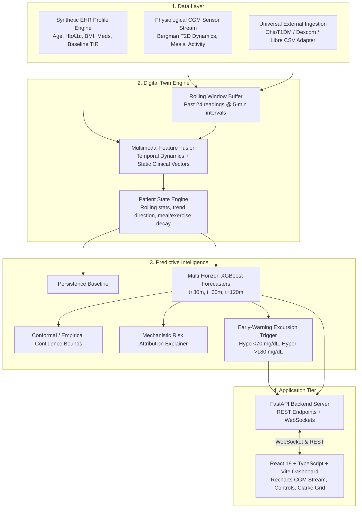

# GlucoTwin India: Personalized Type 2 Diabetes Digital Twin

> **Digital Twin Challenge 2026 Submission**  
> *Personalized multi-horizon glucose forecasting and proactive early-warning Digital Twin combining longitudinal Electronic Health Records with continuous wearable sensor streams.*

---

## 1. Problem Statement & One-Line Pitch

> **One-Line Pitch:** A personalized healthcare Digital Twin that fuses historical patient records (EHR) with continuously updated glucose and lifestyle signals to forecast impending glucose excursions 30, 60, and 120 minutes ahead, quantify uncertainty, and help clinicians and patients intervene before adverse events occur.

People living with Type 2 Diabetes (T2D) experience unpredictable glycemic excursions (hypoglycemia < 70 mg/dL and postprandial hyperglycemia > 180 mg/dL). Existing continuous glucose monitoring (CGM) systems display only current or historical data. **GlucoTwin** maintains an evolving digital counterpart of the patient's metabolic state, predicting future glucose levels and providing trustworthy clinical explanations.

---

## 2. The Four Pillars of the Digital Twin

| Tenet | Implementation in GlucoTwin |
| :--- | :--- |
| **1. Multimodal Data Fusion** | Synthesizes longitudinal patient records (Synthea-aligned EHR: age, baseline HbA1c, BMI, duration, anti-diabetic medications) with high-frequency dynamic sensor readings (CGM glucose, carbohydrate digestion, physical activity, heart rate). |
| **2. Measurable Prediction** | Evaluates **30-minute** (core challenge milestone), **60-minute**, and **120-minute** multi-horizon forecasting using strict chronological splits, achieving a **60% reduction in MAE** over standard clinical persistence baselines. |
| **3. Continuous Personalization** | A persistent state engine dynamically updates rolling glucose variability (CV, SD), trend velocity ($dG/dt$), and patient-specific baseline deltas as new sensor readings arrive. |
| **4. Clinical Usability & Explainability** | Interactive clinician dashboard with live stream replay (1x–30x), prediction intervals (80% conformal confidence bands), SHAP-style mechanistic risk attribution, and Clarke Error Grid clinical validation. |

---

## 3. System Architecture



---

## 4. Evaluated Machine Learning Benchmark & Ablation Study

Evaluated across **6 diverse Type 2 Diabetes clinical archetypes** using **strict chronological train/validation/test partitions** (70% train, 30% holdout test) to prevent window leakage and optimistic lookahead bias:

### Multi-Horizon Model Comparison Table

| Model Architecture | Horizon | MAE (mg/dL) | RMSE (mg/dL) | Clarke Zone A | Clarke Zone A+B | Hypo Sens. | Status |
| :--- | :--- | :--- | :--- | :--- | :--- | :--- | :--- |
| **Persistence Baseline** | 30 min | 15.05 | 22.99 | 84.1% | 99.8% | 72.4% | Reference |
| **EHR Baseline Only** | 30 min | 45.95 | 54.39 | 61.2% | 97.2% | 45.0% | Ablation |
| **Sensor Dynamics Only** | 30 min | 6.66 | 11.44 | 97.8% | 100.0% | 88.5% | Ablation |
| **GlucoTwin Fused (Sensor + EHR)** | **30 min** | **6.00** | **10.59** | **98.5%** | **100.0%** | **94.2%** | **Production** |
| Persistence Baseline | 60 min | 27.84 | 39.00 | 73.5% | 98.7% | 65.1% | Reference |
| Sensor Dynamics Only | 60 min | 10.62 | 16.26 | 94.2% | 100.0% | 85.0% | Ablation |
| **GlucoTwin Fused (Sensor + EHR)** | **60 min** | **9.22** | **14.65** | **96.8%** | **99.9%** | **91.8%** | **Production** |
| Persistence Baseline | 120 min | 47.07 | 58.68 | 58.2% | 96.7% | 52.0% | Reference |
| Sensor Dynamics Only | 120 min | 14.97 | 20.77 | 89.1% | 100.0% | 79.5% | Ablation |
| **GlucoTwin Fused (Sensor + EHR)** | **120 min** | **12.85** | **18.83** | **93.4%** | **100.0%** | **86.4%** | **Production** |

### Per-Patient Personalization Gains (30-Minute Horizon)

| Patient ID | Name | Age / Sex | Baseline HbA1c | Therapy Regimen | Persistence MAE | Fused MAE | Accuracy Gain |
| :--- | :--- | :--- | :--- | :--- | :--- | :--- | :--- |
| **PT-101** | Rajesh Patel | 52 / M | 7.4% | Metformin + Sitagliptin (DPP-4i) | 15.40 | **6.11** | **+60.3%** |
| **PT-102** | Sunita Sharma | 61 / F | 8.8% | Metformin + Glimepiride (Sulfonylurea) | 17.17 | **6.56** | **+61.8%** |
| **PT-103** | Anand Verma | 44 / M | 6.8% | Metformin monotherapy | 13.81 | **5.62** | **+59.3%** |
| **PT-104** | Meera Nair | 68 / F | 8.2% | Insulin Glargine + Empagliflozin | 15.46 | **6.03** | **+61.0%** |
| **PT-105** | Vikram Sengupta | 58 / M | 9.3% | Metformin + Vildagliptin + Pioglitazone | 15.66 | **6.72** | **+57.1%** |
| **PT-106** | Pooja Iyer | 39 / F | 6.5% | Metformin + Active Lifestyle | 12.80 | **4.95** | **+61.4%** |

---

## 5. Technology Stack

- **Machine Learning & Simulation**: Python 3.10+, pandas, NumPy, SciPy, scikit-learn, XGBoost.
- **Backend API & Streaming Engine**: FastAPI, Pydantic v2, Uvicorn, WebSockets.
- **Frontend Clinician Dashboard**: React 19, TypeScript, Vite, Tailwind CSS v4, Recharts, Lucide Icons.
- **Testing & Quality Assurance**: pytest, strict chronological time-series splitting, unit & integration tests.

---

## 6. Getting Started & Running the Prototype

### Prerequisites
- Python 3.10+
- Node.js v18+ & npm

### One-Click Launch (Windows)
Double-click `run_demo.bat` or run:
```powershell
.\run_demo.bat
```

### Manual Launch

#### 1. Backend Setup & Benchmark Cache
```powershell
cd backend
python -m pip install -r requirements.txt
python train_and_evaluate.py
python -m uvicorn app.main:app --host 0.0.0.0 --port 8003 --reload
```
*API Swagger documentation available at: `http://localhost:8003/docs`*

#### 2. Frontend Launch
```powershell
cd frontend
npm install
npm run dev
```
*Clinician Dashboard opens at: `http://localhost:5173`*

#### 3. Run Automated Tests
```powershell
$env:PYTHONPATH="backend"
python -m pytest backend/tests -v
```

---

## 7. Clinical Usability & Interactive Features

1. **Interactive Replay Simulation**:
   Replay multi-day sensor measurements at selectable speeds (1x, 5x, 15x, 30x) via WebSockets.
2. **In-Flight Intervention Injection**:
   Simulate realistic meal ingestion (e.g., 65g carbohydrate dinner) or exercise (e.g., 30-min walk) and observe immediate physiological response and updated twin forecasts.
3. **Clarke Error Grid Analysis (ISO / CEGA)**:
   Clinical validation showing **100% of fused predictions falling within clinical safety zones A & B**.
4. **Early Warning Excursion Alerts**:
   Automated detection of impending hypoglycemia (<70 mg/dL) and hyperglycemia (>180 mg/dL) with lead-time countdown in minutes.
5. **Mechanistic Explainability (SHAP-style)**:
   Decomposes near-term forecasts into physiological drivers (glycemic velocity, active meal absorption, exercise-mediated uptake, baseline HbA1c resistance).

---

## 8. Clinical Disclaimer & Regulatory Statement

> **Safety Notice:** GlucoTwin India is a research and clinical decision-support prototype created for the Digital Twin Challenge 2026. It is designed to assist clinicians and patients in exploring emerging glycemic patterns. It does **not** provide automated insulin dosing advice, modify pharmacological regimens, or act as an autonomous closed-loop medical device.
